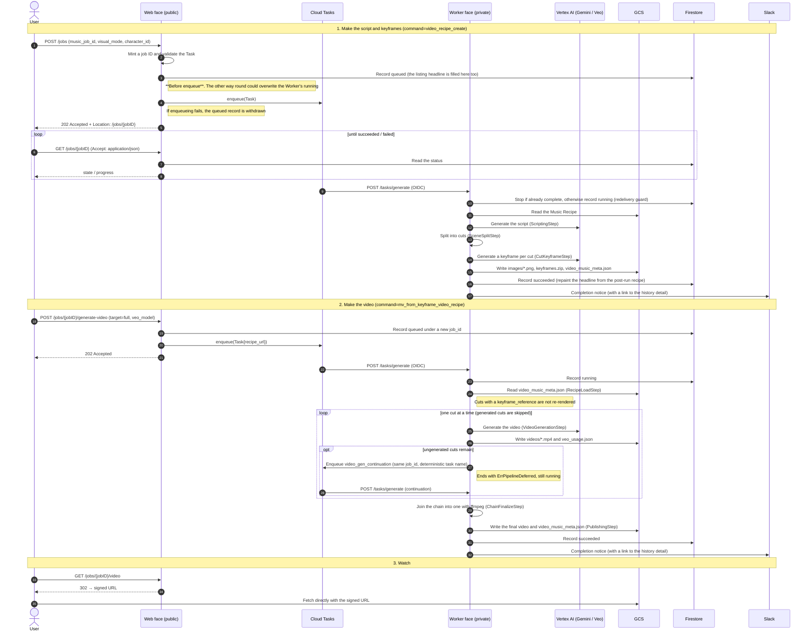

# 🎬 AP MV

[](https://github.com/shouni/ap-mv/actions/workflows/ci.yml)
[](#)
[](https://go.dev/)
[](https://cloud.google.com/run)
[](https://opensource.org/licenses/MIT)

English | [日本語](README.ja.md)

## 🚀 About - Cutting to the beat and the build of the song

**AP MV** is a service on Cloud Run + Cloud Tasks that makes a music video from the Music Recipe
(the song-structure JSON) written by a music-generation service. It has Gemini write a cut-by-cut
script (a VideoRecipe: `visual_anchor` / `audio_cue` / lyrics per cut), generates a keyframe image
for each cut, makes each cut's video with Veo (Vertex AI) and joins them into one with ffmpeg. The
artifacts are a per-job `video_music_meta.json` plus the images and videos, stored under
`gs://<AP_MV_BUCKET>/<VEO_OUTPUT_PREFIX>/jobs/<jobID>/`.

**The script, the keyframes and the videos can be advanced separately.** You can stop at the script
(`video_recipe_draft`) to check the cut list, fix it with `PUT /jobs/{jobID}/recipe`, then render the
images; videos can be remade for all cuts, per section or per cut. Videos are generated one cut at a
time and the worker re-enqueues the rest to Cloud Tasks itself, so even a long song fits within one
task's time limit. Cuts already generated are skipped, so resubmitting the same recipe resumes where
it stopped.

One image is deployed as **two services, a web face (public) and a worker face (private)**, selected
by `SERVER_ROLE`. Images and videos on the pages point at same-origin paths, and the handler 302s to a
GCS signed URL. Only responses to `Accept: application/json` return the signed URL itself.

---

## 📦 Usage

### 1. Configuration

`ValidateEssentialConfig` checks only what each role needs.

**Required for every role**

| Variable | Description |
| --- | --- |
| `SERVER_ROLE` | `web` / `worker` / `both` (`both` is for local development). **Unset or unknown values fail startup.** Only the faces the role serves are built, and only their routes are registered. |
| `GCP_PROJECT_ID` / `GCP_LOCATION_ID` | The GCP project and the region for Cloud Tasks / Vertex AI. Gemini and Veo are called only through Vertex AI (there is no API-key path). |
| `CLOUD_TASKS_QUEUE_ID` | The queue to enqueue to. **The worker also enqueues continuation tasks, so this is required for both roles.** |
| `WORKER_URL` | The URL of the worker **service**, without a path. Roles that serve the worker fall back to `SERVICE_URL` when it is unset, but `web` must set it explicitly. HTTPS is required in production. |
| `TASK_CALLER_SERVICE_ACCOUNT_EMAIL` | The caller SA stamped onto tasks. Cloud Tasks issues the token; this process does not sign anything. |
| `AP_MV_BUCKET` | Where artifacts go. Either `my-bucket` or `gs://my-bucket` is accepted. |
| `GEMINI_MODELS` / `IMAGE_MODELS` / `VEO_MODELS` | Model names for the script, keyframes and video. **Several can be given comma-separated; the first is the default** and the whole list becomes the form's options. **There are no defaults, and startup fails if any one of them is empty.** |
| `VEO_OUTPUT_PREFIX` | The artifact prefix (jobs are laid out under `gs://<AP_MV_BUCKET>/<VEO_OUTPUT_PREFIX>/jobs/`). **There is no default, and startup fails if it is empty.** |

**Required for the web face (`web` / `both`)**

| Variable | Description |
| --- | --- |
| `GOOGLE_CLIENT_ID` / `GOOGLE_CLIENT_SECRET` | The Google OAuth client. |
| `ALLOWED_EMAILS` / `ALLOWED_DOMAINS` | Who may log in (comma-separated). **Startup fails if both are empty.** |
| `ALLOWED_M2M_SERVICE_ACCOUNTS` | SAs allowed when a machine (such as the MCP gateway) calls with an OIDC Bearer token (comma-separated). The audience is `SERVICE_URL`. **Startup fails if it is empty.** |
| `SESSION_FIRESTORE_DATABASE` / `SESSION_FIRESTORE_COLLECTION` | The Firestore where sessions live (both default to `sessions`). **It names a different database from the one for job status.** |

**Required for the worker face (`worker` / `both`)**

| Variable | Description |
| --- | --- |
| `TASK_AUDIENCE_URL` | The audience for Cloud Tasks OIDC verification (the worker's own URL). It falls back to `SERVICE_URL` when unset, so set it explicitly when web and worker are split. |
| `ALLOWED_TASK_SERVICE_ACCOUNTS` | The caller SAs to accept (comma-separated). List both the web and the worker SA (the worker also enqueues continuation tasks). |
| `TASK_DISPATCH_DEADLINE` | How long Cloud Tasks waits for the worker's response (e.g. `30m`). There is no default. |
| `PIPELINE_TIMEOUT` | The run limit for one task (e.g. `25m`). Each continuation task gets its own. **Keep `PIPELINE_TIMEOUT < TASK_DISPATCH_DEADLINE <= Cloud Run's timeout`; equality and unlimited (0 or less) are rejected at startup.** |

**Optional**

| Variable | Description |
| --- | --- |
| `SERVICE_URL` / `PORT` | The public URL and the listening port (Default: `http://localhost:8080` / `8080`). The production `SERVICE_URL` must be HTTPS; it doubles as the OAuth callback, the audience for M2M verification and the base of Slack notification links, so **set the web URL on the worker too**. |
| `LOG_LEVEL` | Log level `DEBUG` / `INFO` / `WARN` / `ERROR` (Default: `INFO`). Read by `main.go`. |
| `FIRESTORE_DATABASE` | The Firestore database for job status (Default: `job-status`). The collection name `ap-mv` is not configurable. |
| `AP_MUSIC_BUCKET` | The bucket used to build `gs://<bucket>/music/<jobID>/recipe.json` from the compose form's Music Job ID. **Same variable name and same rule as the music-generation and narration-generation services.** |
| `VEO_LOCATION_ID` | The Vertex AI location used to call Veo (Default: the value of `GCP_LOCATION_ID`). `global` is accepted. |
| `VEO_ASPECT_RATIO` | `16:9` or `9:16` (Default: `16:9`). A task's `veo_aspect_ratio` takes precedence. |
| `VEO_GENERATE_AUDIO` | Veo's `generateAudio` (Default: `false`). |
| `VEO_POLL_INTERVAL` / `VEO_OPERATION_TIMEOUT` / `VEO_POLL_MAX_ERRORS` | The polling interval for generation operations, the wait limit per cut, and the number of consecutive failures tolerated (Default: `10s` / `20m` / `10`). |
| `VEO_USE_PREVIOUS_VIDEO` | `true` switches to the video_extension (video-to-video) approach, which feeds the previous cut's video as input (Default: `false`). |
| `VEO_PRICE_USD_PER_SEC` | The price table for the estimated cost shown on the history page (comma-separated `model:USD per generated second`; the empty key `:0.40` is the default for models not in the table). Unset means `0.40` for every model. It is not guaranteed to match the bill. |
| `KEYFRAME_MAX_CONCURRENCY` / `KEYFRAME_RATE_INTERVAL` | Concurrency for AI calls and the minimum interval between them (Default: `1` / `60s`). The interval also applies to the script's text generation, and throughput is capped at `1/KEYFRAME_RATE_INTERVAL` regardless of concurrency (raising both logs a warning at startup). |
| `KEYFRAME_IMAGE_SIZE` | Keyframe resolution `1K` / `2K` / `4K` (Default: `2K`). **Anything else fails startup.** |
| `SLACK_WEBHOOK_URL` | Where completion and failure notices go. Unset disables notifications. |

> Environment variables hold only **settings decided by the deployment**. Values that change per run,
> such as the input, the models and the target cuts, are passed in the task payload (JSON). The runtime
> SA's permissions are owned by the Terraform in the separate infrastructure repository.

### 2. Running

```bash
go run .        # SERVER_ROLE is required
```

Only the faces `SERVER_ROLE` serves are built.

| Role | What it builds | Routes exposed |
| --- | --- | --- |
| `web` | The submission form, history pages, enqueueing to Cloud Tasks, Firestore/GCS reads and writes | `/`, `/compose`, `/jobs/*`, `/auth/*` |
| `worker` | The pipeline (Gemini + Veo + ffmpeg + GCS + notifications) and enqueueing to Cloud Tasks (continuation tasks) | `POST /tasks/generate` |
| `both` | Both (for local development) | All of the above |

`go run .` with `both` shows the pages, but **Cloud Tasks cannot deliver to localhost, so the
pipeline never runs.** Verify logic with `go test ./... -race`.

### 3. HTTP endpoints

**There is one authentication.** `auth.Protected` accepts both an OIDC Bearer token (audience
`SERVICE_URL`, an SA in `ALLOWED_M2M_SERVICE_ACCOUNTS`) and a session, so people and machines can
call the same URLs. Only `GET /health` and `/static/*` are outside authentication, and they are
registered regardless of role.

| Method | Path | Purpose |
| --- | --- | --- |
| `GET` | `/health` | Health check (`/healthz` is not used because Cloud Run's default domain treats it as a reserved path). No authentication |
| `GET` | `/static/*` | Embedded CSS / JS and Bootstrap under `vendor/`. No authentication. `vendor/` is `public, max-age=31536000, immutable`, our own assets `public, max-age=300, must-revalidate` |
| `GET` | `/auth/login` `/auth/callback` `/auth/logout` | Google OAuth login, callback and logout |
| `GET` | `/` | Home (the latest 10 jobs and the newest finished video) |
| `GET` | `/compose` | The compose form. The button pressed decides `command` ("Queue Draft Job" = `video_recipe_draft`, "Queue Video Recipe Job" = `video_recipe_create`) |
| `POST` | `/jobs` | Submit a job. Split by `command` in the form body: `video_recipe_create` (default; script → keyframes) / `video_recipe_draft` (script only) / `mv_from_keyframe_video_recipe` (from the VideoRecipe in `recipe_json` or `recipe_url` through to video; for machines). Accepted as `202` with `Location: /jobs/{jobID}` |
| `GET` | `/jobs` | Jobs newest first, 20 per page. `?page=` / `?stage=` (`script` / `keyframes` / `keyframes_done` / `videos` / `completed`; unknown values do not filter). Listed are jobs of `video_recipe_create` / `video_recipe_draft` / `mv_from_keyframe_video_recipe` / `short_video_from_section` / `regenerate_cut_video`; maintenance commands that write back to the original job are not. Jobs without artifacts can be deleted from their row |
| `GET` | `/jobs/{jobID}` | One job, at the same URL from submission to deletion. An unfinished or failed job shows its progress (the page refreshes itself; the JSON gives `queued` / `running` / `succeeded` / `failed` with the failure reason and attempt count). A finished job shows the detail page (each cut's keyframe, video, `visual_anchor` and `dialogue`, the estimated cost, and the ways to remake things), and its JSON is a single document with `detail` (including signed URLs) nested in the status |
| `DELETE` | `/jobs/{jobID}` | Delete a job's artifacts and its status record together. The delete button on the page also sends DELETE via fetch |
| `GET` | `/jobs/{jobID}/recipe` | Return the stored VideoRecipe as `{"job_id", "recipe"}`. This is a separate path from the detail formatted for display, so it can be edited and sent straight back to PUT |
| `PUT` | `/jobs/{jobID}/recipe` | Overwrite the recipe (body is `{"recipe": {...}}` or a bare VideoRecipe, up to 5MB). **Allowed only at the script-only stage (`script`)**; once keyframes are rendered it is 409. Edits that take effect are `visual_anchor` / `audio_cue` / `character_id` / `dialogue`; durations are reassigned from the song's timeline at generation time |
| `GET` | `/jobs/{jobID}/prompt` | Return the recipe as text to paste into Google Flow Music's MV creation. It is one direction note for the whole song, passed together with the song's audio (and optional character art), and the character's appearance is written once at the top. `text/plain` by default; with `Accept: application/json` it is `{"job_id", "prompt", "reference_images"}`. The text is not stored and is rebuilt from the recipe every time |
| `GET` | `/jobs/{jobID}/metadata` | 302 to the signed URL of `video_music_meta.json` |
| `GET` | `/jobs/{jobID}/video` | 302 to the signed URL of the joined final video |
| `GET` | `/jobs/{jobID}/cuts/{cutIndex}/video` | 302 to the signed URL of a single cut's video |
| `GET` | `/jobs/{jobID}/cuts/{cutIndex}/keyframe` | 302 to the signed URL of a cut's keyframe image |
| `GET` | `/jobs/{jobID}/keyframes` | Download all keyframes as `keyframes-{jobID}.zip` (images named like `cut_01.png`, an `inputs.txt` for ffmpeg's concat demuxer, and ASS karaoke subtitles `subtitles.ass` when there are lyrics) |
| `GET` | `/jobs/{jobID}/cuts/{cutIndex}/regenerate` | The form to regenerate a cut's keyframe |
| `POST` | `/jobs/{jobID}/cuts/{cutIndex}/regenerate-keyframe` | Remake a cut's keyframe. Sending `edit_prompt` uses edit mode, which keeps the existing image; empty means a full regeneration (the prompt can be replaced via `visual_anchor`). `overwrite=on` updates the recipe, and `seed` overrides the character seed for this one run. The result is written back to the original job |
| `POST` | `/jobs/{jobID}/cuts/{cutIndex}/regenerate-video` | Remake only a cut's video (the keyframe is reused; `veo_model` may be given). The result is a **new job**; the original job is unchanged |
| `GET` | `/jobs/{jobID}/sections/{sectionIndex}/regenerate` | The form to regenerate keyframes per section (`sectionIndex` is 0-based) |
| `POST` | `/jobs/{jobID}/sections/{sectionIndex}/regenerate-keyframes` | Remake the keyframes of every cut in a section at once. `edit_prompt` / `overwrite` / `seed` work as for a cut (`visual_anchor` is not accepted) |
| `POST` | `/jobs/{jobID}/sections/{sectionIndex}/generate-video` | Take one section from "missing keyframes → video" and write the result back to the original job (`veo_model` may be given). It does not join |
| `POST` | `/jobs/{jobID}/finalize` | Join the videos made per section into one. It generates nothing, so there is no extra charge |
| `POST` | `/jobs/{jobID}/regenerate-zip` | Rebuild `keyframes.zip` and overwrite it on the original job. `primary_color` / `secondary_color` set the subtitle colours |
| `POST` | `/jobs/{jobID}/generate-video` | Generate video from the stored recipe. `target=full` makes the full MV (`mv_from_keyframe_video_recipe`), `target=<section index>` a short of 60 seconds or less (`short_video_from_section`). `veo_model` may be given. The aspect ratio is inherited from when the keyframes were made. The result is a new job |
| `POST` | `/tasks/generate` | The worker, for Cloud Tasks only. Requests that fail OIDC verification get 401; with `SERVER_ROLE=web` **the route is not registered at all**, so it is 404 |

**One resource, one route.** The representation is decided by `Accept`: send `application/json` and
you get JSON, a browser's `Accept` gets the page. Paths follow the URL naming conventions in public-docs.

**Methods with side effects need a CSRF token.** Forms send it as the hidden `csrf_token`, and page JS
sends it in the `X-CSRF-Token` header. Machines authenticated with an OIDC Bearer token skip this check.

### 4. Task payload

`POST /jobs` and each action take a form body and put a task (`domain.Task`) with one of the following
`command`s onto Cloud Tasks. The step sequence is decided by `DefaultPlanner.Plan` in
`internal/pipeline/planner.go`, and each step lives in `internal/pipeline/step/` (file names do not
reflect execution order).

| `command` | What it does | Required fields | Steps (type names in `step/`) |
| --- | --- | --- | --- |
| `video_recipe_draft` | Make and save the script and cut list. **No keyframes are rendered** | One of `source_url` / `text` / `image_url` | `ScriptingStep` → `SceneSplitStep` → `RecipeSaveStep` |
| `video_recipe_create` | Script → keyframes for every cut → zip | Same as above | `ScriptingStep` → `SceneSplitStep` → `CutKeyframeStep` → `ZipUploadStep` |
| `mv_from_keyframe_video_recipe` | From a stored recipe through to video. Cuts that already have a keyframe are not re-rendered | One of `recipe` / `video_recipe` / `recipe_url` | `RecipeLoadStep` → `SceneSplitStep` → `CutKeyframeStep` → `ZipUploadStep` → `VideoGenerationStep` → `ChainFinalizeStep` → `PublishingStep` |
| `short_video_from_section` | Make a single section into a short of 60 seconds or less as a new job | Same as above + `section_index` | `RecipeLoadStep` → `SectionSelectStep` → `VideoGenerationStep` → `ChainFinalizeStep` → `PublishingStep` |
| `section_video` | Make one section's missing keyframes and videos and write the whole recipe back to the original job. Does not join | Same as above + `section_index` | `RecipeLoadStep` → `OriginalJobOutputStep` → `SectionKeyframeStep` → `ZipUploadStep` → `VideoGenerationStep` (limited to the section) → `PublishingStep` |
| `finalize_video` | Re-join the generated cut videos into one. Generates nothing | One of `recipe` / `video_recipe` / `recipe_url` | `RecipeLoadStep` → `OriginalJobOutputStep` → `ChainFinalizeStep` → `PublishingStep` |
| `regenerate_cut_video` | Remake one cut's video (with video_extension, also the rest of its chain) and re-join it into a new job | Same as above + `cut_index` | `RecipeLoadStep` → `CutVideoSelectStep` → `VideoGenerationStep` → `ChainFinalizeStep` → `PublishingStep` |
| `regenerate_cut_keyframe` / `regenerate_section_keyframes` | Remake the keyframe of one cut / of every cut in a section and write it back to the original job | Same as above + `cut_index` / `section_index` | `RecipeLoadStep` → `RegenerateCutKeyframeStep` → `ZipUploadStep` |
| `regenerate_zip` | Rebuild `keyframes.zip` | `recipe_url` | `RecipeLoadStep` → `ZipUploadStep` |
| `video_gen_continuation` | The continuation `VideoGenerationStep` enqueues internally. It carries on the plan of `origin_command` | (built by the worker) | `VideoGenerationStep` → `ChainFinalizeStep` → `PublishingStep` (a `section_video` continuation is `OriginalJobOutputStep` → `VideoGenerationStep` → `PublishingStep`) |

| Field | Description |
| --- | --- |
| `job_id` | The job's identifier, which also decides where artifacts go. Remake commands mint a new ID; those that write back to the original job carry its ID in `original_job_id`. |
| `command` | One of the table above. **It cannot be omitted.** |
| `source_url` / `text` / `image_url` | Input for the script. The form builds `gs://<AP_MUSIC_BUCKET>/music/<jobID>/recipe.json` from `music_job_id` and puts it in `source_url` (machines can pass it directly as `url`). `source_url` accepts `gs://` only. |
| `recipe` / `video_recipe` / `recipe_url` | Input from a stored recipe. `recipe_url` is `gs://.../video_music_meta.json` (Music Recipe JSON is also read as a compatible input and converted to a VideoRecipe). On the form these are `recipe_json` / `recipe_url`. |
| `audio_url` | The `gs://` URI of the audio. It fills every cut's empty `audio_reference`. To vary it per cut, use `video_recipe.cuts[].audio_reference` (which takes precedence). |
| `visual_mode` / `character_id` | The visual style (`assets/prompts/visual_modes/*.md`) and the character. |
| `text_model` / `image_model` / `veo_model` / `veo_aspect_ratio` | Overrides for the models and the aspect ratio (`16:9` / `9:16`). Empty means the first of each `*_MODELS` and `VEO_ASPECT_RATIO`. |
| `cut_index` / `section_index` | The target cut number (1-based) / the section's array index (0-based). |
| `edit_prompt` / `visual_anchor_override` / `seed_override` / `seed_override_character_id` / `overwrite_keyframe` | Instructions for keyframe regeneration (edit mode / prompt replacement / a one-off seed override / whether to update the recipe). |
| `ass_primary_color` / `ass_secondary_color` | Karaoke subtitle colours for sung / not-yet-sung text (CSS hex). |

```json
{
  "command": "video_recipe_create",
  "job_id": "video-recipe-20260904-101500-1a2b3c4d5e6f",
  "source_url": "gs://<music-bucket>/music/20260711132823-256e9128/recipe.json",
  "visual_mode": "default",
  "character_id": "zunda",
  "veo_aspect_ratio": "16:9"
}
```

```json
{
  "command": "mv_from_keyframe_video_recipe",
  "job_id": "mv-20260904-113000-9f8e7d6c5b4a",
  "recipe_url": "gs://ap-mv/veo/jobs/video-recipe-20260904-101500-1a2b3c4d5e6f/video_music_meta.json",
  "audio_url": "gs://<music-bucket>/music/20260711132823-256e9128/music.mp3",
  "veo_model": "veo-3.1-generate-preview"
}
```

**Continuation tasks carry the recipe in the payload.** `video_gen_continuation` holds a
`video_recipe` including what has been generated, plus `origin_command`, and is enqueued with the same `job_id`.

---

## 🔄 Sequence diagram



## 🌳 Project structure

```text
ap-mv/
├── main.go                  # Entry point (logger setup, server start)
├── Dockerfile               # scratch image (static binary only)
├── cloudbuild.yaml          # Build and deploy to two services (ap-mv / ap-mv-worker)
├── assets/                  # Embedded (prompts/{video_recipe,visual_modes,video_gen}, templates/*.html, static/)
└── internal/
    ├── config/              # Loading environment variables and per-role validation
    ├── server/              # chi router, graceful shutdown
    │   └── handlers/        #   Web face (submission form, listing, detail, artifact 302s, remakes)
    ├── domain/              # Task model, command constants, job status and progress stages, recipe types, subtitles, cost
    ├── ports/               # In-app boundaries (VideoRunner / TaskQueue / HistoryRepository / VideoProcessor)
    ├── app/                 # DI container and resource management
    ├── builder/             # Wiring external dependencies, handlers and the pipeline (Cloud Tasks enqueueing lives here too)
    ├── repository/          # History (listing in Firestore, detail and zip in GCS), recipe reads/writes, job status
    ├── pipeline/            # The worker itself. planner.go decides the step sequence from command
    │   └── step/            #   Each step (recipe_load / scripting / scene_split / cut_gen / video_gen / chain_finalize / publishing and more)
    └── adapters/            # Vertex AI (Gemini, Veo) / ffmpeg / Slack
        └── prompt/          #   Prompts sent to Gemini (script, keyframes)
```

---

## 📜 License

* This project is released under the [MIT License](https://opensource.org/licenses/MIT).
